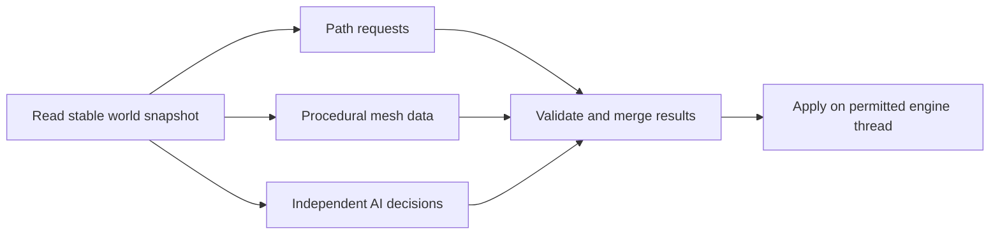

# 8. Threads, jobs and background work

Several cooks can prepare different ingredients together. They cannot all safely change the same pan at once, and handing out tiny tasks can cost more time than cooking them.

## Before adding workers

Confirm there is enough independent work. Identify the critical path: tasks that depend on earlier tasks cannot all run simultaneously. Parallelize an expensive, well-defined region rather than one trivial operation per entity. Batch size trades scheduling overhead against load balancing and latency.

A useful design is read-only inputs, independent output buffers, then a controlled merge. Define who owns memory before, during and after a task. Give results a world/version identifier so old tasks can be discarded after a level change. Avoid holding a lock while doing I/O or calling an engine API that may itself wait.

## A small dependency plan

This is an architectural example, not an implemented job system in the repository. Physics, rendering and active scene changes may have engine-specific thread restrictions. Read [Godot's thread-safety rules](research.md#r06) and the matching engine-version documentation before touching those systems.

## Contention and false sharing

A shared counter or common work queue can become a bottleneck even when tasks look independent. Measure lock wait, queue time and worker utilization, not just sum of worker CPU time. Atomic operations preserve certain access guarantees; they are not free and do not automatically make an entire algorithm correct.

False sharing happens when different workers repeatedly write separate values that occupy the same cache line. That can create traffic even without a logical shared variable. Per-worker buffers, coarser work blocks or appropriate layout may help. Blind padding wastes memory and should follow evidence.

## Determinism and lifetime

Parallel completion order can change floating-point reduction results and random-number use. For rollback or lockstep simulation, define deterministic scheduling/reduction policies or carefully restrict what runs in parallel. Seeded randomness alone does not make an arbitrarily scheduled computation deterministic.

Cancellation needs a clear state machine. Ensure a task cannot write to destroyed/reused objects; handles with generations or owned result messages can help. A worker queue needs capacity and overload policy. More threads than available compute resources can increase context-switching and contention.

## Language-specific limits

Async I/O avoids occupying a thread while waiting; it does not inherently accelerate CPU arithmetic. JavaScript's async functions still run CPU work on their executing thread unless a worker is used. Python parallelism depends on implementation/build and whether extensions release interpreter locks; threads are not a blanket CPU speedup. Go goroutines are scheduled tasks, not one dedicated CPU core each. Rust's type system prevents many ownership mistakes, but safe code can still deadlock or scale poorly.

Measure end-to-end wall time, latency distribution, memory and synchronization under representative load. Read [Amdahl](research.md#r01), [Gustafson](research.md#r37), [Tracy](research.md#r20) and [Go diagnostics](research.md#r22). Next: [language tools](09-language-tools.md).
